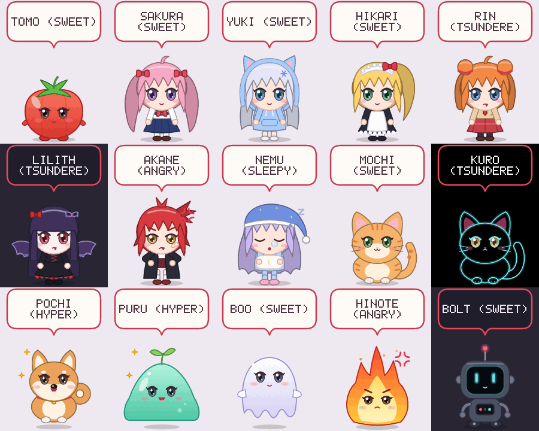
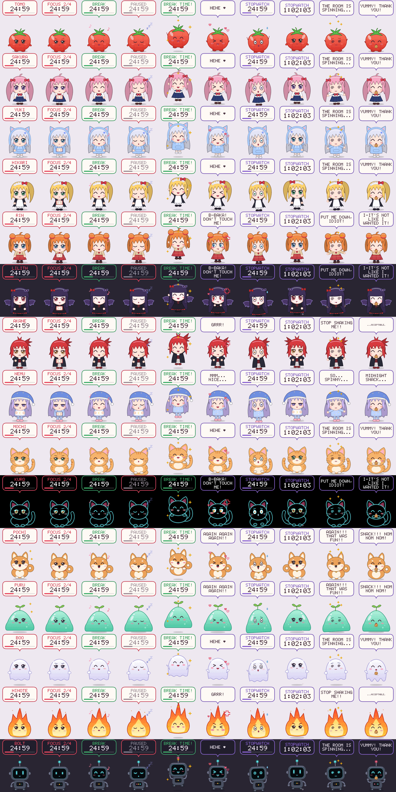
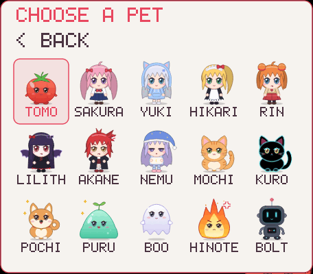

<p align="center"></p>

<h1 align="center">Petodoro</h1>

<p align="center">A tiny desktop pet that floats on your screen and keeps you company with a
<b>pomodoro timer</b> and a <b>stopwatch</b>. Pick it up, drop it anywhere, pat it,
feed it, shake it (it gets dizzy) and watch it wander around.<br>
Runs on <b>Linux</b>, <b>Windows</b> and <b>macOS</b> with about 5 MB of RAM and almost no CPU.</p>

<p align="center">
<a href="https://github.com/Switchharsh/petodoro/releases/latest/download/petodoro-amd64.deb"></a>
<a href="https://github.com/Switchharsh/petodoro/releases/latest/download/petodoro-windows.exe"></a>
<a href="https://github.com/Switchharsh/petodoro/releases/latest/download/petodoro-macos.zip"></a>
<br>
<a href="https://github.com/Switchharsh/petodoro/releases/latest"></a>
<a href="https://github.com/Switchharsh/petodoro/releases/latest"></a>
<a href="https://github.com/Switchharsh/petodoro/actions/workflows/ci.yml"></a>
</p>



## Install

Nothing else is needed: no Rust, no runtimes. Pick your system:

### 🐧 Linux Mint / Ubuntu / Debian
Click the **Linux Mint / Ubuntu** button above, double-click the downloaded
`petodoro-amd64.deb`, press **Install Package**, then open **Petodoro** from the
app menu. Or, in a terminal (installs into your home folder, adds a menu entry,
starts on login):

```sh
curl -fsSL https://raw.githubusercontent.com/Switchharsh/petodoro/HEAD/get.sh | bash
```

ARM (Raspberry Pi etc.): `petodoro-arm64.deb` from the
[Releases page](https://github.com/Switchharsh/petodoro/releases/latest).
Any other Linux: the portable `petodoro-x86_64-linux.tar.gz`, unpack and run `./petodoro`.

### 🪟 Windows 10 / 11
Click the **Windows** button above and double-click `petodoro-windows.exe`.
Windows may show *"Windows protected your PC"* because the app isn't signed:
click **More info → Run anyway**. To add it to the Start menu and start it on
login, run this in PowerShell:

```powershell
irm https://raw.githubusercontent.com/Switchharsh/petodoro/HEAD/get.ps1 | iex
```

### 🍎 macOS 11+
Click the **macOS** button above, unzip, and drag **Petodoro.app** into
Applications. The app isn't notarized, so the first time **right-click it →
Open → Open**. Or, in Terminal:

```sh
curl -fsSL https://raw.githubusercontent.com/Switchharsh/petodoro/HEAD/get.sh | bash
```

### From source (any system)
`git clone` this repo and run `./install.sh` (Linux/macOS). It installs Rust
if needed, builds, and runs `petodoro --install`. On Windows:
`cargo build --release`, then `target\release\petodoro.exe --install`.

**Uninstall:** `petodoro --uninstall` (or `sudo apt remove petodoro` for the `.deb`).

> Releases are built automatically by CI for every platform: every push to the
> default branch publishes the version in `Cargo.toml`. Bump that version to
> start a new release.

## The pets

Each pet has a **personality** that changes its face, how fast it moves, how
quickly it falls asleep, and everything it says.

| Pet        | Personality | Looks like                                   | Theme  |
|------------|-------------|----------------------------------------------|--------|
| **Tomo**   | sweet       | the Petodoro mascot: a little tomato 🍅      | light  |
| **Sakura** | sweet       | pink twin-tails, sailor uniform              | light  |
| **Yuki**   | sweet       | silver hair, cat-ear hoodie                  | light  |
| **Hikari** | sweet       | blonde ponytail, maid outfit                 | light  |
| **Rin**    | tsundere    | orange twin buns, school blazer, fang        | light  |
| **Lilith** | tsundere    | gothic vampire girl with bat wings           | dark   |
| **Akane**  | angry       | red-haired delinquent with a bandage         | light  |
| **Nemu**   | sleepy      | pajamas, nightcap, hugs her pillow           | light  |
| **Mochi**  | sweet       | orange tabby cat                             | light  |
| **Kuro**   | tsundere    | pure-black neon cat, made for AMOLED screens | amoled |
| **Pochi**  | hyper       | shiba inu with endless zoomies               | light  |
| **Puru**   | hyper       | bouncy slime with a sprout                   | light  |
| **Boo**    | sweet       | little floating ghost                        | light  |
| **Hinote** | angry       | tiny fire spirit with a short fuse           | light  |
| **Bolt**   | sweet       | robot with a glowing LED face                | dark   |

- **Sweet**: smiles, hearts, cheers you on.
- **Tsundere**: pouts, crosses her arms, blushes and looks away when patted.
  *"B-BAKA! DON'T TOUCH ME!"* Gets softer as your friendship level rises.
- **Angry**: scowls, keeps her hands on her hips, shows anger marks 💢. *"WORK. OR ELSE."*
- **Sleepy**: half-closed eyes, nods off after 40 seconds, blows snot bubbles. *"FIVE MORE MINUTES..."*
- **Hyper**: bounces nonstop, sparkly eyes, walks around often, talks a lot.
  *"LET'S CRUSH IT!!!"* Great company if you have ADHD and like a bit of
  energy (and noise) next to your work.

The bubble and menu can be **light**, **dark** or **AMOLED** (pure black). By
default they follow the pet; change it from the menu or with `--theme`.

Every pet in every mood (idle, focus, break, asleep, cheering, patted, held,
walking, dizzy, eating):



## Things to do with your pet

| Do this                       | And this happens                                         |
|-------------------------------|----------------------------------------------------------|
| **Drag** the pet              | pick it up and drop it anywhere                          |
| **Shake** it while dragging   | it gets dizzy (spiral eyes, stars)                       |
| **Click** the speech bubble   | start / pause the timer                                  |
| **Click** the pet             | pat it; click fast for a **combo counter** (fidget toy!) |
| **Middle-click**              | reset the timer                                          |
| **Scroll** on the pet         | ±1 minute on a phase that hasn't started yet             |
| **Right-click**               | menu (big, readable text; grows with the pet's size)     |

- **Talks**: it greets you, reacts to pats, snacks and shakes, cheers when a
  session ends, and sometimes reminds you to drink water or stretch
  (turn this off with *CHATTER*).
- **Snacks**: *GIVE A SNACK* in the menu, and it munches a cookie. Overfeed it
  and it complains.
- **Friendship**: pats, snacks and finished pomodoros raise your friendship
  level with each pet, shown in the menu title. High levels unlock nicer
  lines (even from the tsunderes).
- **Walks around**: when nothing's running it wanders along the screen
  sometimes (never during a focus session). Turn it off with *WALK AROUND*.
- **Daily stats**: the menu shows today's pomodoros and focus minutes.
- **Break tips**: the end-of-focus notification suggests something healthy to
  do with your break.
- **Short sessions**: focus can be as short as 5 minutes, which helps for
  getting started on days when 25 feels like too much.

**The menu** has three pages:
- **Main**: start/pause/reset/skip, **CHOOSE PET**, give a snack, mode
  (pomodoro / stopwatch / just pet), size (S–XL), settings, quit.
- **Choose pet**: every pet at a glance; click one to switch instantly.
- **Settings**: today's stats, theme, focus/break/long-break lengths,
  auto-start next phase, walking, chatter, sound, start on login.

Left-click moves a setting forward and right-click moves it back.

<p align="center"></p>

### Command line

```
petodoro --pet kuro            # choose a pet (see --list-pets)
petodoro --mode stopwatch      # pomodoro | stopwatch | pet
petodoro --theme amoled        # auto | light | dark | amoled
petodoro --scale 2             # bigger pet
petodoro --focus 50 --break 10 # custom pomodoro lengths
petodoro --reset-position      # lost your pet? bring it back to the corner
petodoro --install / --uninstall
petodoro --autostart on|off
petodoro --list-pets
petodoro --gallery pets.png    # render every pet
petodoro --preview sheet.png   # render every pet in every mood
```

Settings, friendship and stats live in `~/.config/petodoro/config` (plain
text). Only one pet runs at a time.

## Light on resources

About 5 MB of RAM and under 0.5% of one CPU core, even while a timer runs or
the pet walks. It's written in Rust and talks to the windowing system directly
(X11, Win32 or Cocoa; no GTK, Qt, Electron or GPU). It only redraws when something visible changes, reuses cached animation
frames, and sleeps in between. The program is about 1.3 MB.

## Troubleshooting

- **Black box around the pet**: your compositor is off. Petodoro then cuts
  the window to the pet's outline, so edges look slightly jaggier but it
  still works. Cinnamon always has compositing on.
- **No sound**: Petodoro uses `paplay` / `pw-play` with the freedesktop
  "complete" sound, falling back to `canberra-gtk-play` and then the system
  bell. You can turn sound off in the menu.
- **No notification**: run `sudo apt install libnotify-bin`.
- **Wayland**: it runs through XWayland, but some Wayland compositors won't
  keep it on top or let it move itself. Mint's default Cinnamon session is
  X11, where everything works.
- **Windows SmartScreen / macOS Gatekeeper warnings**: the downloads aren't
  code-signed (that costs money every year). Use *More info → Run anyway* on
  Windows, or *right-click → Open* on macOS.
- **macOS is new**: it's built and checked by CI on every release but has had
  less real-world use than Linux and Windows. Please open an issue if
  something looks off.
- **`.deb` won't install on an older Mint**: release builds need glibc 2.35
  (Mint 21 or newer). On older systems, build from source.

## How it's built

```
src/
  main.rs       command line + event loop (sleeps on poll() until the next frame is due)
  app.rs        state: timers, moods, mouse, shaking, walking, speech, menu
  platform/     one backend per OS: x11.rs (Linux), win32.rs (Windows), macos.rs (Cocoa)
  render.rs     speech bubble + themes, menu, pet-frame cache, preview sheets
  pets/         the pets, as vector shapes in a 100x100 box (girl rig, cat, dog, ...)
  lines.rs      what each personality says
  font.rs       5x7 pixel font (no font files to ship)
  timer.rs      pomodoro / stopwatch state machines (unit tested)
  config.rs     settings, friendship, daily stats
  system.rs     notifications, sounds, autostart, --install, single instance
scripts/              .deb and macOS .app packaging (used by CI)
get.sh / get.ps1      one-line installers (Linux & macOS / Windows)
```

Dependencies: [`tiny-skia`](https://crates.io/crates/tiny-skia) (a CPU 2D
renderer) plus one per OS: [`x11rb`](https://crates.io/crates/x11rb),
[`windows-sys`](https://crates.io/crates/windows-sys) or
[`objc2`](https://crates.io/crates/objc2). Run the tests with `cargo test`.

**Adding a pet**: add a file in `src/pets/` (or a new `Style` for the girl
rig in `girl.rs`), register it in `pets/mod.rs` with a personality, then
check every mood with `petodoro --preview out.png`.

## License

MIT. The pets are original artwork drawn in code for this project and are
covered by the same license.
