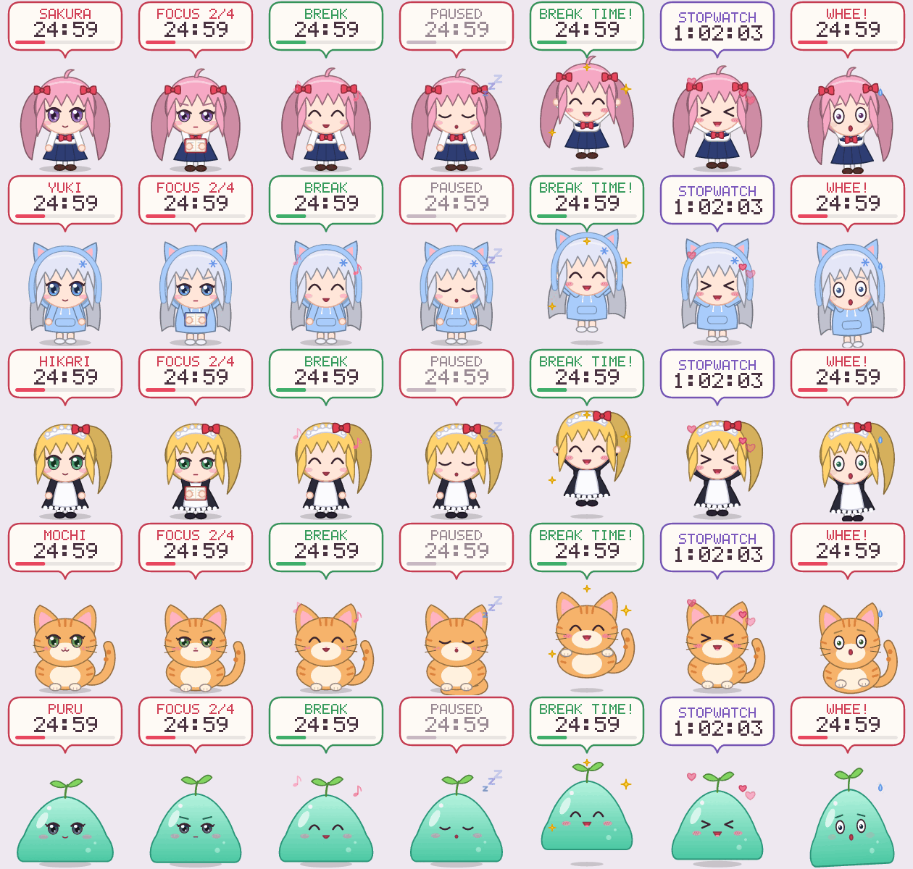

# Petodoro 🍅

A tiny desktop pet that floats on your screen and keeps you company with a
**pomodoro timer** and a **stopwatch**. Pick it up, drop it anywhere, pat it
on the head. Made for Linux Mint (and any other X11 desktop).



## Features

- **Floating pet**: an always-on-top, borderless, transparent window. Drag it
  anywhere and it remembers where you left it. Clicks on transparent pixels go
  through to the windows underneath.
- **Pomodoro**: focus / short break / long break cycles (25/5/15 minutes by
  default, with a long break every 4 sessions). You get a desktop notification
  and a chime at the end of each phase, and the pet celebrates.
- **Stopwatch**: start, pause and reset.
- **Just-pet mode**: hides the speech bubble so only the pet is shown.
- **5 original pets**, all drawn as vector art so they stay sharp at any size:

  | Pet        | Description                       |
  |------------|-----------------------------------|
  | **Sakura** | pink twin-tails, sailor uniform    |
  | **Yuki**   | silver hair, cat-ear hoodie        |
  | **Hikari** | blonde ponytail, maid outfit       |
  | **Mochi**  | orange tabby cat                   |
  | **Puru**   | slime with a little sprout         |

  Each pet has 7 moods: idle (blinks and breathes), focus (reads a book),
  break (hums), sleepy (dozes off after 3 minutes with nothing happening),
  cheering (a phase just ended), love (you clicked it) and held (you're
  dragging it).
- **Light on resources**: about 4–5 MB of RAM and well under 1% of one CPU
  core. It's written in Rust and talks to X11 directly with no GTK, Qt or
  GPU, and it only redraws when something on screen actually changes. The
  binary is about 1 MB.

## Install (Linux Mint / Ubuntu / Debian)

```sh
git clone <this repo> petodoro
cd petodoro
./install.sh
```

That's it. The script will:

1. offer to install Rust through [rustup](https://rustup.rs) if you don't have
   it. Rust is only needed to build. `sudo apt install cargo` also works
   (Rust 1.75 or newer).
2. build Petodoro. It's pure Rust, so **no `-dev` packages are needed**.
3. install it to `~/.local/bin/petodoro`, add **Petodoro** to your app menu
   with an icon, offer to start it on login, and launch it.

Use `./install.sh -y` to accept every default without being asked.

A prebuilt `petodoro-x86_64-linux.tar.gz` is attached to tagged GitHub
releases (built by CI). Unpack it and run `./install.sh` inside to skip the
build entirely.

To remove it: `./uninstall.sh` (add `--purge` to also delete your settings).

## Using it

| Do this                       | And this happens                                   |
|-------------------------------|----------------------------------------------------|
| **Drag** the pet              | pick it up and drop it anywhere                    |
| **Click** the speech bubble   | start / pause the timer                            |
| **Click** the pet             | pet them ♥                                         |
| **Middle-click**              | reset the timer                                    |
| **Scroll** on the pet         | ±1 minute on a phase that hasn't started yet       |
| **Right-click**               | menu                                               |

The right-click menu has pause/resume/reset/skip and lets you change the
mode (pomodoro / stopwatch / just pet), the pet, the size (S/M/L/XL), focus,
break and long break lengths, auto-start next phase, sound, start on login,
and quit. In the menu, left-click moves a setting forward and right-click
moves it back.

### Command line

```
petodoro --pet yuki            # choose a pet (sakura, yuki, hikari, mochi, puru)
petodoro --mode stopwatch      # pomodoro | stopwatch | pet
petodoro --scale 2             # bigger pet
petodoro --focus 50 --break 10 # custom pomodoro lengths
petodoro --reset-position      # lost your pet? bring it back to the corner
petodoro --autostart on|off    # start on login
petodoro --list-pets
petodoro --preview sheet.png   # render every pet in every mood
petodoro --help
```

Settings are saved to `~/.config/petodoro/config` (plain `key = value` text
that you can edit by hand). Only one pet runs at a time, so launching it
again does nothing.

## Troubleshooting

- **Black box around the pet**: your desktop compositor is off. Petodoro
  then cuts the window to the pet's outline, so edges look a little jaggier
  but it still works. Cinnamon always has compositing on.
- **No sound**: Petodoro plays the freedesktop "complete" sound with
  `paplay`. If that's missing it tries `pw-play` and `canberra-gtk-play`, and
  finally the system bell. Turn sound off from the menu.
- **No notification**: notifications use `notify-send` (`sudo apt install
  libnotify-bin`).
- **Wayland**: Petodoro runs through XWayland, but some Wayland compositors
  don't allow always-on-top windows or let apps place their own windows.
  Linux Mint's default Cinnamon session is X11, where everything works.

## How it's built

```
src/
  main.rs       command line + event loop (sleeps on poll() until the next frame is due)
  app.rs        state: timers, moods, mouse handling, menu
  platform.rs   X11: ARGB window, always-on-top hints, SHAPE input regions, popup menu
  render.rs     speech bubble, menu, pet-frame cache, preview sheet
  pets/         the pets, drawn as vector shapes in a 100x100 box
  font.rs       5x7 pixel font (no font files to ship)
  timer.rs      pomodoro / stopwatch state machines (unit tested)
  config.rs     settings file
  system.rs     notify-send, sounds, autostart, single-instance lock
```

Dependencies: [`x11rb`](https://crates.io/crates/x11rb) (a pure-Rust X11
protocol client) and [`tiny-skia`](https://crates.io/crates/tiny-skia)
(a CPU 2D renderer). Run the tests with `cargo test`.

Want another pet? Add a file in `src/pets/`, draw it with the helpers in
`gfx.rs`, and register it in `pets/mod.rs`. `petodoro --preview out.png`
shows how it looks in every mood.

## License

MIT. The pets are original artwork drawn in code for this project and are
covered by the same license.
